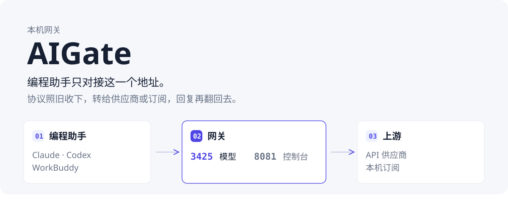
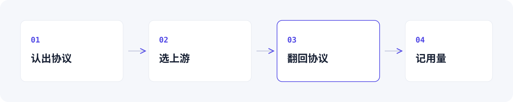

编程助手各自带一套协议和密钥。AIGate 在本机收口：应用仍用自己的协议说话，网关转给配置好的 API 供应商，或转给这台电脑上已经登录的订阅，再把回复翻回去。一家还没开始答复、并且路由允许时，换下一家。每次调用记在同一本用量账上。

## 一次请求怎样走完



应用把基地址设成网关源 `http://127.0.0.1:3425`，再接自己的路径。带不带 `/v1` 是同一种协议。

| 协议 | 路径 |
| --- | --- |
| Chat Completions | `POST /v1/chat/completions`、`POST /chat/completions` |
| Responses | `POST /v1/responses`、`POST /responses` |
| Anthropic Messages | `POST /v1/messages`、`POST /messages` |
| Gemini | `POST /v1beta/models/{model}:generateContent` 或 `:streamGenerateContent` |
| Ollama | `POST /api/chat` |

同一协议原样转发，只换上游模型名。不同协议之间翻译正文、流式事件、工具调用和推理文本。调用方看到的名字仍是目录里的那个。

`GET /v1/models`、`GET /models`、`GET /api/tags`、`GET /v1beta/models` 返回目录。`GET /api/hello` 返回 `{"name":"aigate"}`，不需要令牌。

路由用一个名字按顺序尝试多家。默认只在上游不可达时换下一家。鉴权失败、限流、额度用尽要在这条路由里单独允许才会继续。回复已经开始交给应用之后，不再换。同一段对话尽量留在上次答过的那一家。会话标识用请求里的 `x-session-id`、`x-claude-code-session-id`、`x-conversation-id` 或 `conversation-id`。没有标识就不编造会话，也不留下正文。

## 快速开始

需要 Go 1.26.8。

```
go test ./...
go build -o bin/aigate ./cmd/aigate
```

然后运行 `bin/aigate`（Windows 上是 `bin\aigate.exe`）。开发时也可以 `go run ./cmd/aigate`。

打开 `http://127.0.0.1:8081` 进入本机控制台。

控制台改配置，网关读同一份快照。控制台地址不接受模型请求，网关地址不接受登录。两个监听写成同一个主机和端口时，两个都不打开。

改了 `web/` 里的页面后，先构建再编译。页面嵌在 `internal/console/ui/dist`。

```
cd web
npm ci
npm run build
```

## 接入应用

控制台的 Agent 页检测已安装的编程助手。接入改的是那个应用自己的文件：基地址指向网关，密钥写成 `aigate-<应用名>`，模型列表写成当前目录。

本机环回上，这把密钥会被接受，并记成调用方。另一台机器，或带 `X-Forwarded-For`、`Forwarded` 的请求，要使用控制台发放的网关令牌。

| 应用 | 接入时改的文件 |
| --- | --- |
| Claude Code | `~/.claude/settings.json` |
| Codex | `~/.codex/config.toml` |
| WorkBuddy | `~/.workbuddy/models.json` |
| OpenCode | `~/.config/opencode/opencode.json`，已有 `opencode.jsonc` 时改那份 |
| Gemini CLI | `~/.gemini/.env`、`~/.gemini/settings.json` |
| Aider | `~/.aider.conf.yml` |
| Cursor | 不改文件。在 Cursor 里把 OpenAI Base URL 设成网关源加 `/v1`，密钥填 `aigate-cursor` |

没有可提供的对话模型、网关没在听，或文件读不出来时，接入不写文件。只在启动时读菜单的应用，接入之后要重新打开。

## 订阅登录

提供方页读取本机已经登录的助手，和手工添加的 API 密钥排在一起。令牌留在原来的文件里。关掉「读取本机订阅登录」后，这些文件不再读。

能读到的有 Claude Code、Codex、GitHub Copilot、Gemini CLI、Antigravity、WorkBuddy。文件缺失是未登录。文件解析失败时这一行还在，模型名单不当成空的。

## 配置

默认文件在用户配置目录的 `aigate/config.json`。Windows 上是 `%APPDATA%\aigate\config.json`。设置 `AIGATE_CONFIG` 时只用那个文件。用量在同目录的 `usage/attempts.jsonl`，结束的对话在 `usage/conversations/`。

网关默认只听本机。给别的机器用时，在控制台打开共享，并把监听改成非环回地址。那些请求必须带发放的网关令牌。令牌可以限制可见和可调用的模型，明文只在创建时出现一次。控制台会话不能当作网关令牌。

配置读不出来时，网关不接受模型请求。控制台页面仍能打开。坏文件会挪到旁边的 `.bad`。

供应商密钥、网关令牌和订阅令牌不会出现在读取接口里。

插件可以在控制台里保存和排序。进程现在不加载插件。还没落地的决定见 [设计记录](docs/design/README.md)。

一次请求的完整路径见 [网关链路](docs/gateway-chain.md)。已经跑起来的行为见 [docs/subsystems](docs/subsystems/README.md)。产品承诺见 [产品需求](docs/gateway-prd.md)。
