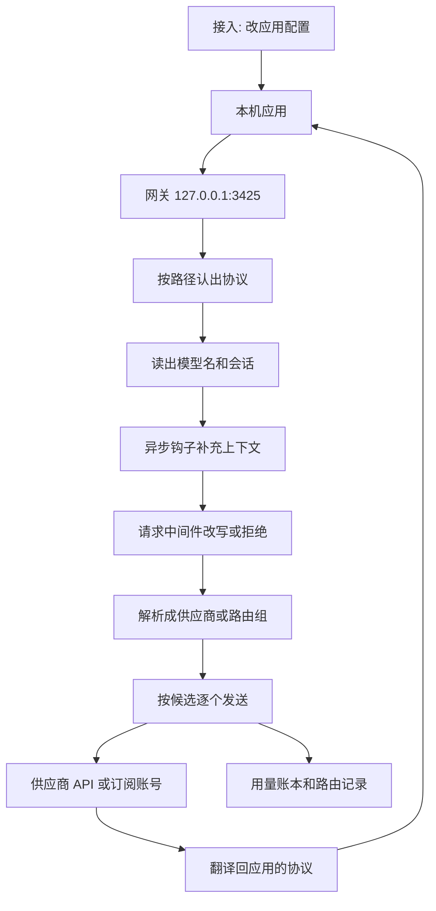

# 网关链路

网关是本机上的一个 HTTP 服务，默认听在 `127.0.0.1:3425`。Codex、Claude Code、WorkBuddy 这类应用把对话发给它，它再转给真正的供应商或订阅账号，并把回复翻回应用自己的协议。

这篇只描述这条路径上有哪些部分、一次对话怎样走完。各段的完整行为、边界和失败情况在文末的设计说明里。

## 各部分

| 部分 | 做什么 |
| --- | --- |
| 本机应用 | 用自己的协议发起对话，例如 Chat Completions、Responses、Anthropic Messages、Gemini、Ollama |
| 接入 | 把应用的配置指到网关：基地址、密钥、模型列表。断开时把应用原来的配置放回去 |
| 网关进程 | 桌面程序打开时，或单独启动网关服务时，占住上述地址 |
| 模型目录 | 用户添加的 API 地址和密钥、订阅登录、把多家合成一个名字的路由组 |
| 协议入口 | 按请求路径认出应用说的是哪一种协议 |
| 异步钩子 | 选定供应商之前，可以往正文里补充上下文。回复交给应用之后，可以观察这次回复 |
| 请求中间件 | 选定供应商之前可以改正文或拒绝。每一次尝试可以只改发往这一家的正文，也可以跳过某个订阅账号。回复途中可以改流式事件 |
| 路由 | 把模型名解析成一个供应商或一个路由组，排出密钥和账号的尝试顺序，失败时换下一家 |
| 供应商与订阅 | 真正调用模型。订阅里已经交给插件的，仍由网关把这次请求交给插件发出 |
| 用量与会话 | 记下这次调用选了谁、花了多少、属于哪一段对话，供用量页、路由页和会话页使用 |

## 接入

用户在界面上把某个应用接上之后，改的是这个应用自己的配置，不是网关里的一份名单。

- 基地址写成网关地址。
- 密钥写成本机调用名，形如 `aigate-claude`。`magpie` 和 `magpie-<名>` 也仍被记成调用方。网关靠这个名字、请求路径和客户端标识认出是谁在调用。
- 模型列表写成网关当前能提供的目录。应用菜单里看到的模型，是这份目录，不是应用厂商自己的私有列表。

没有可用模型，或模型都被隐藏时，接入不会写成一份空列表冒充成功。有的应用只在启动时读这份列表，接上之后需要重新打开它。

网关进程有两种开法：打开桌面程序，或只启动网关、不打开窗口。端口已被占用时，说明已经有一个网关在服务，后启动的不再占第二个。

## 进入网关

应用的对话按路径进入对应协议：

| 应用说的协议 | 路径 |
| --- | --- |
| Chat Completions | `POST /v1/chat/completions` |
| Responses | `POST /v1/responses` |
| Anthropic Messages | `POST /v1/messages` |
| Gemini | `POST /v1beta/models/{模型}:{方法}` |
| Ollama | `POST /api/chat` |

入口先读出正文里的模型名，再从请求头里认这段对话。应用自己带了会话标识时，用它把同一次对话的请求归到一起。个别应用新版本不再带这个标识，网关会用它本机上的会话文件，和这次请求里的用户原文对上。

标题、摘要、压缩这类附属请求在入口单独处理，不进入下面的选路。普通对话继续往下。

## 选定发给谁

应用发来的对话，在选路之前经过两层加工。网关自己发起的请求不经过这两层，见文末。

异步钩子跑在插件宿主里。它可以往正文里补充上下文。模型名、是否流式、工具声明保持应用原来的值。它不能拒绝这次请求。钩子失败、超时或改了不该改的字段时，正文回到它接受的上一份，请求继续。

请求中间件跑在网关进程里，挂在每一次应用请求上。它可以改正文，也可以直接拒绝并把错误按应用的协议返回。拒绝或改写只影响这一次请求。

然后网关把模型名解析成一个供应商，或一个路由组。候选按这些规则排列：

- 这个供应商有哪些密钥、哪些订阅账号。
- 路由组把多家放在同一个名字下，一起参与排序。
- 路由策略决定尝试顺序。同一段对话可以固定在上一次用的那一家，让上下文缓存还在。
- 暂停规则可以把某些账号或密钥暂时拿开。
- 主选暂时不能接时，按备用列表继续。

每一次尝试发送之前：

- 中间件可以跳过某个订阅账号。跳过的账号不休息、不记失败，换下一个。密钥的尝试不走这一步。
- 正文翻译成这一家真正接受的协议。
- 中间件可以只改这一次要发出去的正文。对这一家的修改不会带到下一家。

这一次失败，并且还没有开始把回复交给应用时，换下一个候选。候选都试完仍不能服务，应用收到失败，原因按最后一次实际发生的情况返回。

## 回复怎么回去

供应商的回复边收边翻译成应用原来的协议，流式输出保持流式。请求中间件可以改这些事件，也可以改整份 JSON 回复。

回复写完后记一条用量：谁调用的、用了哪个模型、哪家服务的、花了多久、是否失败。路由页能看到这次为什么选了这一家、中途换过谁。会话页把网关看到的调用，和这个应用自己写在磁盘上的会话合在一起；两边是同一段对话时，以应用自己的会话为准。

异步钩子在回复交给应用之后得到通知。这个通知不挡住应用收完回复。请求失败、流中途断开，或回复大到无法整份保留时，钩子被告知这次没有一份完整回复。

## 不经过两层加工的请求

网关自己发起的请求直接选路发送。这包括对话标题、路由里用的分类、以及搜索和识图时替模型做的那一次调用。它们发生在某次应用请求的过程中时，也不使用那次请求的钩子和中间件。搜索、识图、记忆同时是交给应用的 MCP 服务：应用调用这些工具，工具再向网关要模型。

## 同时开着的其它入口

这三件事和一次对话并行，不改变上面的路径：

- 模型列表把当前目录交给应用，让应用菜单和网关能服务的模型一致。
- 用量和配额给界面和命令行看这次以及历史调用。
- 局域网或另一台机器上的调用使用单独发放的网关密钥。本机应用使用的密钥，和发给别人的密钥，在钩子里被看成不同来源。

## 更细的说明

| 想继续看 | 设计说明 |
| --- | --- |
| 接入怎样改每个应用的配置 | [Agent wiring](subsystems/agent-wiring.md) |
| 怎样选供应商、密钥、账号和备用 | [Gateway routing and fallback](subsystems/gateway-routing.md) |
| 会话怎样归并 | [Gateway Session Aggregation](subsystems/gateway-sessions.md) |
| 请求中间件 | [Gateway middleware](subsystems/gateway-middleware.md) |
| 异步钩子 | [Asynchronous gateway hooks](subsystems/gateway-request-hooks.md) |
| 供应商和订阅账号 | [Providers and accounts](subsystems/providers-accounts.md) |
| 订阅交给插件之后谁在服务 | [Provider and plugin ownership](subsystems/provider-plugins.md) |
